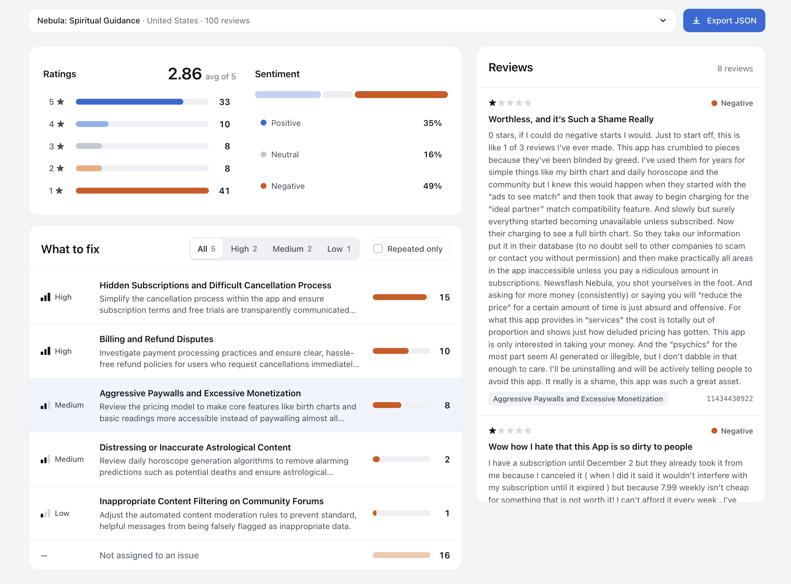

# App Store Review Analyzer

Collect App Store reviews, measure ratings and sentiment, and turn recurring complaints into prioritized, evidence-linked actions. A FastAPI API and browser dashboard share one analysis pipeline.

[Live dashboard](https://app-store-review-analyzer-795908196054.europe-central2.run.app) · [Live API docs](https://app-store-review-analyzer-795908196054.europe-central2.run.app/docs)

## Run locally

Install [uv](https://docs.astral.sh/uv/). Python 3.12 is pinned and installed automatically by uv when needed. Copy `.env.example` to `.env` and set `GEMINI_API_KEY`.

```bash
uv sync --locked
uv run --env-file .env uvicorn app.main:app --host 127.0.0.1 --port 8000 --workers 1
```

Open the [dashboard](http://127.0.0.1:8000/) or [interactive API docs](http://127.0.0.1:8000/docs). The first startup downloads the sentiment model. Analysis needs internet access to Apple and Gemini; collection alone needs no Gemini key. Prepared review text is sent to Google for insights.

```bash
curl -X POST http://127.0.0.1:8000/api/analyze \
  -H 'Content-Type: application/json' \
  -d '{"app_id":"1459969523","country":"us","review_count":100}'
```

| Endpoint | Result |
|---|---|
| `POST /api/analyze` | Reviews, metrics, prioritized insights, and evidence |
| `POST /api/reviews/collect` | Raw reviews and collection metadata; same request body |
| `GET /api/health` | Model readiness and credential availability |

Responses are JSON. The dashboard visualizes distributions, issue frequency/coverage, and supporting reviews, and downloads the report locally.

## Approach and design

- **One service:** FastAPI serves the API and a vanilla JavaScript dashboard, with no frontend build step, database, or queue.
- **Bounded collection:** Apple catalog, RSS, then webpage fallback; retain the first unique reviews in source order and report shortfalls.
- **Independent sentiment:** Pinned CardiffNLP RoBERTa classifies text on CPU. Star ratings never determine sentiment. Emoji become words and oversized text is trimmed for models; original comments remain in the report.
- **Evidence-linked insights:** Gemini groups negative complaints and proposes short actions by priority and recurrence. Positive/neutral reviews provide context. Invalid evidence is rejected, with one bounded repair attempt; an empty issue list is valid.
- **Local metrics:** Python calculates averages, distributions, unique issue frequencies, and coverage from review IDs. The API keeps reports in memory; one analysis or collection runs at a time, with busy responses and configurable usage limits.

Sentiment and issue interpretation are model estimates. The classifier is English-oriented; selecting a storefront does not filter review language. Logs and traces contain timings and diagnostics, excluding review contents and credentials.

## Service metrics per request

Latest verified cloud request on **2026-10-16**: Nebula analysis using **PyTorch batch size 1**, **1 vCPU, 4 GiB RAM, and one inference thread** in Warsaw. Requested **100 reviews**, collected **10**: Apple throttled later pages with HTTP 429, leaving an explicitly reported shortfall of 90 reviews. The request succeeded with three validated issues.

| Processing stage | Measured time |
|---|---:|
| Review collection, including fallback attempts | 35.104 s |
| App information lookup | 0.154 s |
| Text preprocessing | 0.038 s |
| Sentiment inference on CPU (10 reviews) | 15.741 s |
| Gemini insight generation | 8.670 s |
| Evidence validation | 1.5 ms |
| Rating, sentiment, and issue metrics | 0.2 ms |
| **Complete analysis pipeline** | **59.713 s** |
| **Complete HTTP request** | **59.718 s** |

Stage timings come from the structured request log; totals include orchestration and response handling. This partial sample cannot establish a speedup against the earlier 100-review run. See [rollout verification](docs/deployment.md#batch-size-1-rollout--2026-10-16).

Estimated processing cost for the **same 10-review batch-1 request**, using actual provider token counts:

| Cost component | Usage | Estimated cost (USD) |
|---|---|---:|
| Cloud Run CPU | 59.72 vCPU-seconds | $0.00129 |
| Cloud Run allocated memory | 238.87 GiB-seconds | $0.00057 |
| Gemini input | 3,862 tokens | $0.00116 |
| Gemini output | 401 tokens | $0.00100 |
| **Total processing estimate** | **One 10-review request** | **$0.00402 (~0.4 cents)** |

Estimates use paid list prices before free-tier allowances, credits, discounts, and taxes. Cloud Run startup/idle time, builds, storage, networking, logs, and traces are additional; this is not the full billed cost or a fixed price. Review length, repairs, and instance performance change each request's usage. See [calculation and pricing sources](docs/deployment.md#per-request-cost-calculation).

An [ONNX/quantization benchmark](docs/sentiment-benchmark.md) now compares the Xenova conversion against PyTorch. On the local ARM Mac, batch size 1 improved PyTorch inference from 7.71 to 6.33 seconds; quantized ONNX was slower and changed some labels. Production inference now uses PyTorch batch size 1; the ONNX backends remain experimental. Both tables above describe the latest 10-review cloud check; they do not predict the time or cost of a complete 100-review analysis.

## Application example: Nebula



The supplied US-storefront report for **Nebula: Spiritual Guidance** (app ID `1459969523`), collected on **2026-10-15**, contains **100 unique reviews** with an average rating of **2.86/5**. Sentiment is **35% positive, 16% neutral, and 49% negative**. Five issue groups cover **33 of 49 negative reviews (67.3%)**; 16 negative reviews remain unassigned.

| Priority | Improvement | Reviews | Recurrence |
|---|---|---:|---|
| High | Clarify subscription terms and simplify cancellation | 15 | Repeated |
| High | Improve billing and refund handling | 10 | Repeated |
| Medium | Make core features more accessible | 8 | Repeated |
| Medium | Review alarming or inaccurate horoscope content | 2 | Repeated |
| Low | Reduce false positives in community content filtering | 1 | Single |

The screenshot shows the paywall issue selected, so its review panel displays **8 supporting reviews** from the full 100-review report. Issue counts can overlap because one review may mention several problems.

Read the [sample report](examples/nebula-report.md) or inspect the [original exported JSON with source reviews and evidence](examples/nebula-report.json). These are reported experiences in this sample, not independently verified defects or a measurement of all Nebula users.

[Deployment instructions](docs/deployment.md) include the Warsaw target, Cloud Build container checks, and rollback steps.
