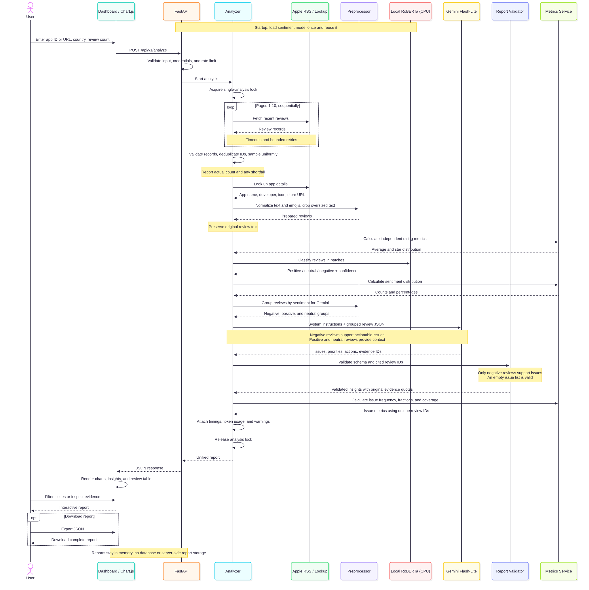

# App Store Review Analyzer

One FastAPI application collects App Store reviews, classifies sentiment on CPU, generates evidence-linked Gemini insights, and serves an interactive dashboard. Reports include independent rating/sentiment metrics, issue frequencies, coverage, and source reviews.

## Analysis flow



[PNG image](docs/sequence.png) · [Mermaid source](docs/sequence.mmd)

## Run locally

Python 3.12 is pinned for compatibility with Hydra and the container. Install [uv](https://docs.astral.sh/uv/) and Node.js, then set `GEMINI_API_KEY` in `.env` using `.env.example` as a guide.

```bash
uv sync --locked
npm ci --prefix frontend
npm run --prefix frontend build
uv run --env-file .env uvicorn app.main:app --host 127.0.0.1 --port 8000 --workers 1
```

Open [the dashboard](http://127.0.0.1:8000/) or [API documentation](http://127.0.0.1:8000/docs). Enter an app ID or App Store URL, country from the full-name dropdown, and review count. API routes use `/api/analyze`, `/api/reviews/collect`, `/api/metrics`, and `/api/health`. Charts render in the browser with bundled Chart.js; the backend returns JSON. The first local startup may download the pinned sentiment model. Docker bundles its weights instead.

The service keeps no reports in a database or on disk. The browser holds the current report and downloads JSON locally. Negative reviews support improvement recommendations; positive and neutral reviews provide context. Shortfalls and incomplete collections are reported explicitly.

## Test the API

With the server running, check readiness:

```bash
curl http://127.0.0.1:8000/api/health
```

Collect up to 100 reviews from Apple’s catalog reviews endpoint without model analysis. Change `country` to `ua` for Ukraine or use another two-letter country code:

```bash
curl -X POST http://127.0.0.1:8000/api/reviews/collect \
  -H 'Content-Type: application/json' \
  -d '{
    "app_id": "1459969523",
    "country": "us",
    "review_count": 100,
    "seed": 42
  }'
```

Run the complete analysis, including sentiment, Gemini insights, and metrics:

```bash
curl -X POST http://127.0.0.1:8000/api/analyze \
  -H 'Content-Type: application/json' \
  -d '{
    "app_id": "389801252",
    "country": "us",
    "review_count": 100,
    "seed": 42
  }'
```

Calculate metrics from supplied reviews without calling either model:

```bash
curl -X POST http://127.0.0.1:8000/api/metrics \
  -H 'Content-Type: application/json' \
  -d '{
    "reviews": [
      {
        "id": "example-1",
        "title": "Freezes",
        "text": "The app freezes when opening photos.",
        "rating": 2,
        "sentiment": "negative"
      }
    ],
    "insights": {
      "issues": [
        {
          "category": "Freezing when opening photos",
          "priority": "high",
          "evidence_ids": ["example-1"]
        }
      ]
    }
  }'
```

The metrics request uses illustrative data. Omit `insights` for rating and sentiment metrics only. All API responses are JSON; routes have no `/v1` prefix.

## Run the pipeline without the dashboard

```bash
uv run --env-file .env review-analyzer 389801252 --output output/report.json
```

This runs the same services as the API. The older per-step scripts remain optional compatibility tools. Reproducible experiments use `uv run --env-file .env python -m experiments.analyze` with Hydra overrides.

## Verify

```bash
uv run --locked pytest -q
npm test --prefix frontend
```

- [Infrastructure plan](INFRASTRUCTURE.md)
- [Architecture, API, and pipeline](docs/architecture.md)
- [Dashboard and JSON contract](docs/dashboard.md)
- [Docker and Cloud Run deployment](docs/deployment.md)
- [Assignment](TEST_TASK.md) and [research checklist](RESEARCH_TODO.md)

Cloud deployment files are prepared; no cloud resources have been created or deployed.
